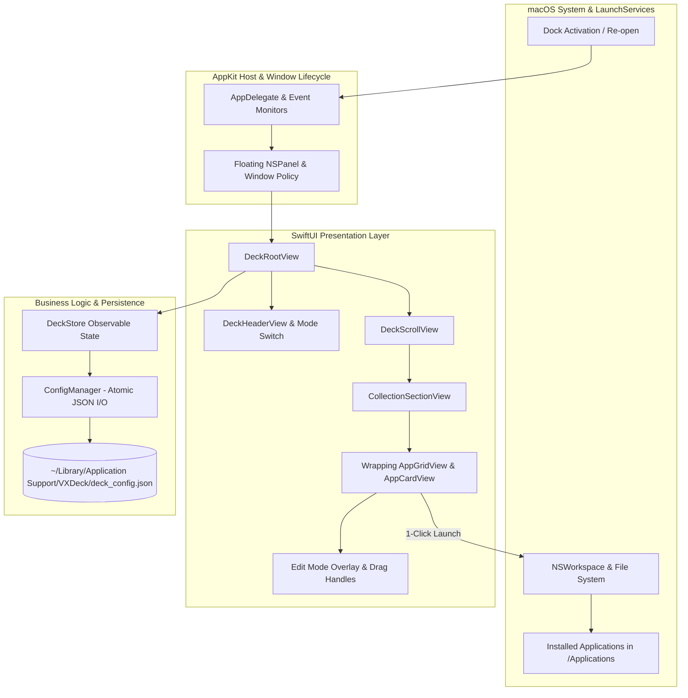

# 00. Tổng quan Hệ thống — VXDeck (`_spec0_system`)

> **Tên sản phẩm:** VXDeck (Lightweight Curated Application Launcher Popup)  
> **Thư mục dự án:** `vxdeck`  
> **Phiên bản tài liệu:** 1.0.0  
> **Ngày cập nhật:** 2026-10-28  
> **Nền tảng mục tiêu:** macOS (Apple Silicon & Intel) — macOS 14.0+ (Tối ưu hóa sâu cho macOS 26 / SDK 27.0)  
> **Tài liệu nguồn phạm vi (Scope Source of Truth):** [VXDeck_MVP_Scope.md](../../VXDeck_MVP_Scope.md)  
> **Quy chuẩn tuân thủ:** [desktop_ui_standards.md](../../../.agents/desktop_ui_standards.md) và [master_theme.md](../../../_summary/master_theme.md)

---

## 1. Bối cảnh & Tôn chỉ Sản phẩm (Product Vision)

### 1.1. Nỗi đau thực tế trên macOS 26
Trên macOS 26, sự thay đổi và thay thế của hệ thống Launchpad truyền thống khiến nhiều người dùng cảm thấy mất đi khả năng tự do sắp xếp, phân nhóm ứng dụng theo không gian trực quan (spatial arrangement).
Trong khi đó, các giải pháp thay thế hiện có đều tồn tại nhược điểm:
1. **Spotlight / Raycast / Alfred:** Yêu cầu người dùng phải nhớ tên ứng dụng và gõ phím. Không phù hợp với nhu cầu kích hoạt nhanh bằng chuột khi đang làm việc sáng tạo, hoặc khi người dùng muốn nhìn thấy một "bảng chọn" các công cụ thuộc một danh mục cụ thể (như nhóm đồ họa, nhóm lập trình, nhóm văn phòng).
2. **Thanh Dock mặc định của macOS:** Không gian hiển thị có hạn, nếu nhồi nhét quá nhiều biểu tượng sẽ khiến Dock bị thu nhỏ lí nhí, rối mắt và khó bấm trúng.
3. **Các trình quản lý ứng dụng bên thứ ba:** Quá nặng nề, can thiệp sâu vào hệ thống, yêu cầu quyền Accessibility/Full Disk Access hoặc cố gắng quét và lập chỉ mục toàn bộ hàng trăm app trong máy.

### 1.2. Định nghĩa & Sứ mệnh của VXDeck
VXDeck là **bảng sưu tập ứng dụng nổi dạng popup (Curated Application Launcher Board)** dành riêng cho macOS.

**Tôn chỉ cốt lõi phân định ranh giới (Non-Goals & Core Principles):**
- **Không tái tạo Launchpad toàn màn hình:** VXDeck chỉ là một cửa sổ popup nổi không viền (borderless floating popup), xuất hiện nhanh chóng trên màn hình hiện tại khi bấm biểu tượng trên Dock.
- **Không cạnh tranh với Spotlight / Fuzzy Search:** Ứng dụng không lập chỉ mục toàn bộ ổ đĩa, không chạy tiến trình nền quét file, không làm công cụ tìm kiếm hệ thống.
- **Chỉ hiển thị những gì người dùng chọn (Explicit User Curation):** Không tự động đổ toàn bộ hàng trăm ứng dụng trong `/Applications` vào bảng. Người dùng chủ động tạo các bộ sưu tập (Collections) và tự tay thêm các ứng dụng mình thực sự dùng thường xuyên.
- **Khởi chạy 1-chạm (1-Click Launch):** Nhấp chuột một lần vào biểu tượng để kích hoạt ứng dụng qua API native macOS (`NSWorkspace.shared.openApplication`), sau đó popup tự động ẩn mượt mà.
- **An toàn tuyệt đối (Read & Launch Only):** VXDeck chỉ lưu đường dẫn và Bundle ID. Không bao giờ sửa đổi, ghi đè, xóa hoặc di chuyển các tệp `.app` gốc đã cài đặt. Xóa shortcut hoặc xóa Collection trong VXDeck chỉ xóa cấu hình cục bộ của app.
- **Zero-Cloud & Zero-Privilege:** Không tài khoản, không đám mây, không thu thập dữ liệu (telemetry), không đòi hỏi quyền Admin hay quyền trợ năng (Accessibility).

---

## 2. Ma trận Độ khó Kỹ thuật & Giải pháp Kiến trúc (Difficulty Matrix)

```text
┌────────────────────────────────────────────────────────────────────────┐
│               MA TRẬN ĐỘ KHÓ KỸ THUẬT (DIFFICULTY MATRIX)              │
├────────────────────────┬─────────────┬─────────────────────────────────┤
│ Hạng mục Kỹ thuật      │ Mức độ khó  │ Thách thức cốt lõi & Nguy cơ    │
├────────────────────────┼─────────────┼─────────────────────────────────┤
│ 1. Borderless Floating │ ★★★★☆ (8.0) │ Mất focus, đúp cửa sổ khi bấm   │
│    NSPanel Lifecycle   │             │ Dock nhiều lần, xử lý Escape    │
├────────────────────────┼─────────────┼─────────────────────────────────┤
│ 2. SwiftUI Drag & Drop │ ★★★★☆ (8.5) │ Xung đột giữa click launch và   │
│    Grid Reordering     │             │ drag reorder; kéo xuyên nhóm    │
├────────────────────────┼─────────────┼─────────────────────────────────┤
│ 3. Safe App Discovery  │ ★★★☆☆ (7.5) │ Trích xuất icon chuẩn Retina,   │
│    & Launch Activation │             │ xử lý app bị đổi tên/di chuyển  │
├────────────────────────┼─────────────┼─────────────────────────────────┤
│ 4. Non-Xcode Build     │ ★★★★☆ (8.0) │ Đóng gói .app bundle hoàn chỉnh │
│    & SPM Architecture  │             │ chỉ dùng Swift CLI / CLT        │
├────────────────────────┼─────────────┼─────────────────────────────────┤
│ 5. Atomic JSON Storage │ ★★★☆☆ (7.0) │ Nguy cơ hỏng file cấu hình khi  │
│    & Graceful Fallback │             │ crash; đồng bộ trạng thái FSM   │
└────────────────────────┴─────────────┴─────────────────────────────────┘
```

### Điểm khó 1: Vòng đời Cửa sổ Nổi Borderless NSPanel & Tương tác Dock (Độ khó: 8.0/10)
- **Vấn đề kỹ thuật:**
  - Ứng dụng hiển thị dưới dạng một popup không viền (`borderless`), không có thanh tiêu đề hay nút traffic lights native.
  - Khi người dùng bấm vào icon VXDeck trên Dock: Nếu popup đang ẩn thì phải hiện ngay tại màn hình đang có con trỏ chuột/Dock; nếu popup đang hiện nhưng bị che khuất thì đưa lên trước (Bring to front). Tuyệt đối không sinh thêm cửa sổ thứ hai.
  - Phân định rõ ràng: **Click Dock luôn là hành vi Show / Bring to Front**. Không áp dụng toggle trên icon Dock để loại trừ triệt để xung đột thứ tự sự kiện (Race condition) giữa sự kiện click chuột ngoài (`NSEvent.addGlobalMonitorForEvents`) và callback `applicationShouldHandleReopen(_:hasVisibleWindows:)`.
  - Khi người dùng bấm ra ngoài (Outside Click) hoặc nhấn phím `Escape`: Popup phải ẩn đi, nhưng **tiến trình VXDeck vẫn chạy nền nhẹ nhàng trên thanh Dock** để sẵn sàng mở lại tức thì.
  - Khi người dùng click khởi chạy một app: Focus phải được chuyển giao mượt mà cho app đích trên luồng chính (`MainActor`), không được chiếm lại focus (focus stealing).
- **Giải pháp kiến trúc:**
  - Sử dụng AppKit `NSPanel` với `styleMask = [.borderless, .nonactivatingPanel]`, `level = .floating` và override `var canBecomeKey: Bool { return true }` để tiếp nhận phím `Escape` và phím tắt.
  - Thiết lập `AppDelegate` can thiệp vào `applicationShouldHandleReopen`: luôn gọi `panel.makeKeyAndOrderFront(nil)` và trả về `false` để ngăn hành vi mặc định của AppKit.
  - Đăng ký bộ lắng nghe sự kiện toàn cục `NSEvent.addGlobalMonitorForEvents(matching: [.leftMouseDown, .rightMouseDown])` để phát hiện click bên ngoài cửa sổ và kích hoạt lệnh ẩn.
  - Riêng trong **Edit Mode** hoặc khi mở hộp thoại `NSOpenPanel`: Vô hiệu hóa việc tự ẩn khi mất focus tạm thời, gán cờ `is_modal_open = true` để giữ cửa sổ cha hiển thị liên tục suốt phiên chọn file.

### Điểm khó 2: Kéo Thả Sắp Xếp (Drag & Drop) trong Lưới và Xuyên Bộ Sưu Tập (Độ khó: 8.5/10)
- **Vấn đề kỹ thuật:**
  - Trong SwiftUI, nếu gắn cử chỉ kéo thả (DragGesture hoặc `.onDrag` / `.dropDestination`) lên cùng một phần tử với TapGesture (`.onTapGesture`), hệ thống rất dễ nhận diện nhầm một thao tác nhấp chuột thành bắt đầu kéo, hoặc ngược lại (vô tình mở app khi người dùng chỉ muốn kéo di chuyển).
  - Kéo thả giữa các Collection xếp chồng theo chiều dọc đòi hỏi tính toán vị trí chèn (insertion index) chính xác trong lưới nhiều cột (Wrapping Grid).
- **Giải pháp kiến trúc:**
  - Tách bạch rõ ràng 2 trạng thái hoạt động: **View Mode (Chế độ xem & mở app)** và **Edit Mode (Chế độ chỉnh sửa & sắp xếp)**:
    - Ở *View Mode*: Tương tác click được ưu tiên hàng đầu, vô hiệu hóa hoàn toàn cử chỉ kéo để đảm bảo độ nhạy 1-chạm cực nhanh (Zero-Latency Launch).
    - Ở *Edit Mode*: Hiển thị huy hiệu chỉnh sửa, tay cầm kéo (drag handle), kích hoạt API `.draggable()` / `.dropDestination()` của SwiftUI với Uniform Type Identifier (UTI) định danh riêng (`com.vxdeck.app-item`). Tắt hành vi khởi chạy app khi click ở chế độ này.
  - Sử dụng mô hình mảng phẳng theo thứ tự hiển thị `display_order` trong từng Collection Model để việc cập nhật vị trí trong RAM diễn ra tức thì (O(1) feedback).

### Điểm khó 3: Trích xuất Biểu tượng Native & Khởi chạy Ứng dụng An toàn (Độ khó: 7.5/10)
- **Vấn đề kỹ thuật:**
  - Nếu chỉ lưu đường dẫn cứng (hardcoded path như `/Applications/Figma.app`), khi người dùng di chuyển app sang thư mục con hoặc đổi tên, shortcut sẽ bị hỏng.
  - Trích xuất icon bằng cách đọc file `.icns` thủ công rất dễ gặp lỗi đối với các app đóng gói đặc thù hoặc app tải từ App Store.
- **Giải pháp kiến trúc:**
  - Lưu trữ định danh kép: **Bundle Identifier** (ví dụ `com.figma.Desktop`) làm khóa định danh bền vững, kèm **File Path** làm phương án dự phòng.
  - Khi nạp dữ liệu: Dùng `NSWorkspace.shared.urlForApplication(withBundleIdentifier:)` để dò tìm vị trí mới nhất của app nếu đường dẫn cũ không tồn tại.
  - Trích xuất icon native sắc nét bằng `NSWorkspace.shared.icon(forFile: path)`, tự động hỗ trợ màn hình Retina với kích thước hiển thị chuẩn 48×48pt hoặc 64×64pt.
  - Khi app mục tiêu bị gỡ bỏ hoặc không tìm thấy: Hiển thị trạng thái **Unavailable (Biểu tượng xám mờ + nhãn cảnh báo)**, click vào hiển thị menu ngữ cảnh cho phép: "Tìm lại ứng dụng..." hoặc "Xóa khỏi danh sách". Tuyệt đối không bao giờ cố mở sai ứng dụng khác.

### Điểm khó 4: Đóng gói macOS App Bundle Không cần Xcode IDE & Pin SDK 27.0 (Độ khó: 8.0/10)
- **Vấn đề kỹ thuật:**
  - Máy phát triển và môi trường CI chạy dòng lệnh terminal với Xcode Command Line Tools (CLT) và Swift Package Manager (SPM), không phụ thuộc vào Xcode.app đồ họa nặng hàng chục GB.
  - Lệnh `swift build` thông thường chỉ xuất ra file nhị phân Mach-O trần trụi (CLI executable), không có cấu trúc `.app` bundle, thiếu `Info.plist`, icon bundle và metadata cần thiết để macOS LaunchServices nhận diện như một ứng dụng Dock chuẩn.
- **Giải pháp kiến trúc:**
  - Thiết kế quy trình đóng gói chuẩn thông qua SPM kết hợp kịch bản đóng gói tự động (`scripts/bundle_app.sh`):
    1. Pin baseline **macOS SDK 27.0** theo chuẩn workspace VXUtilities; kiểm tra metadata executable bằng script kiểm định SDK.
    2. Biên dịch nhị phân tối ưu hóa với `swift build -c release --arch arm64` (hoặc universal binary khi phát hành).
    3. Tạo cấu trúc bundle chuẩn: `VXDeck.app/Contents/MacOS/`, `Contents/Resources/`, `Contents/Info.plist`.
    4. Tạo file `Info.plist` bắt buộc có đủ các khóa metadata:
       - `CFBundleExecutable = VXDeck`
       - `CFBundleIdentifier = com.ztools.vxdeck`
       - `CFBundleName = VXDeck`
       - `CFBundleDisplayName = VXDeck`
       - `CFBundlePackageType = APPL`
       - `CFBundleShortVersionString = 1.0.0`
       - `CFBundleVersion = 1`
       - `CFBundleIconFile = AppIcon`
       - `LSMinimumSystemVersion = 14.0`
       - `NSHighResolutionCapable = true`
       - `LSUIElement = false` (bảo đảm hiển thị biểu tượng trên thanh Dock)
    5. Ký số ad-hoc cục bộ cho artifact thử nghiệm: `codesign --force --sign - VXDeck.app`.

### Điểm khó 5: Lưu trữ Cấu hình Nguyên tử (Atomic Persistence) & Bảo Toàn Phiên (Độ khó: 7.0/10)
- **Vấn đề kỹ thuật:**
  - Thao tác kéo thả sắp xếp diễn ra liên tục. Nếu lưu đĩa bất đồng bộ có debounce mà người dùng bấm `Cmd + Q` thoát app ngay, dữ liệu chỉnh sửa cuối cùng có thể bị mất.
  - Nếu tệp JSON bị hỏng do nguyên nhân ngoài ý muốn, việc tự động ghi đè tệp rỗng sẽ làm mất toàn bộ cấu hình người dùng.
- **Giải pháp kiến trúc:**
  - Áp dụng mô hình **Single Serial Writer (Actor hoặc Serial Queue)** quản lý tuần tự hóa các yêu cầu ghi, gắn số thứ tự sửa đổi (`revision: Int`).
  - Hỗ trợ hàm `flush()` ép ghi đồng bộ ngay lập tức trước khi thoát ứng dụng trong `applicationWillTerminate` hoặc khi người dùng bấm hoàn tất Edit Mode.
  - Áp dụng **Quy tắc Ghi Nguyên tử (Atomic Write via Staging File)**:
    - Ghi dữ liệu ra tệp tạm `.deck_config.json.tmp.<uuid>`.
    - Gọi hàm đồng bộ đĩa vật lý (`fsync` / `FileHandle.synchronize()`).
    - Dùng lệnh nguyên tử `rename` / `replaceItemAt` để ghi đè tệp chính.
  - Khi phát hiện tệp JSON bị lỗi cú pháp không giải mã được: Tự động đổi tên tệp hỏng thành `.deck_config.json.corrupt.<timestamp>` để lưu vết khôi phục cho người dùng, tuyệt đối không tự ý xóa hoặc ghi đè rỗng lên tệp dữ liệu cũ.

---

## 3. Kiến trúc Tổng thể & Công nghệ Lựa chọn

### 3.1. Tech Stack
- **Ngôn ngữ:** Swift 6.0+ (Hiện đại, an toàn bộ nhớ, concurrency chuẩn).
- **Giao diện (UI):** SwiftUI (Khai báo mượt mà, hỗ trợ Grid và Dark/Light mode tự nhiên).
- **Cửa sổ & Tích hợp Hệ điều hành (Windowing & OS Bridge):** AppKit (`NSPanel`, `NSWindowController`, `NSApplicationDelegate`, `NSWorkspace`, `NSEvent`).
- **Quản lý gói & Bản dựng:** Swift Package Manager (`Package.swift`).
- **Hệ điều hành mục tiêu:** macOS 14.0+ (Sonoma, Sequoia, macOS 26), SDK 27.0 baseline.

### 3.2. Sơ đồ Kiến trúc Phân tầng (Layered Architecture)



---

## 4. Cấu trúc Thư mục Dự án Chuẩn

```text
vxdeck/
├── Package.swift                     # Khai báo gói SPM, dependencies và targets
├── VXDeck_MVP_Scope.md               # Tài liệu Scope MVP gốc
├── README.md                         # Hướng dẫn biên dịch, đóng gói và sử dụng
├── docs/
│   ├── codex_review_spec_task.md     # Yêu cầu review chỉ đọc gửi Codex CLI
│   ├── codex_review_spec_response.md # Báo cáo phản biện và khuyến nghị từ Codex
│   └── spec/                         # Bộ đặc tả kỹ thuật Single Source of Truth
│       ├── 00_system_overview.md     # Tài liệu này (Tổng quan hệ thống)
│       ├── 01_business_process.md    # BPMN, SIPOC và ma trận quyết định
│       ├── 02_feature_flow.md        # User flows, sequence diagrams, FSM
│       ├── 03_ui_wireframe.md        # Bố cục UI, Component specs, Design tokens
│       ├── 04_api_data.md            # Data models, JSON schema, OS contracts
│       ├── 05_qa_acceptance.md       # Tiêu chuẩn nghiệm thu Gherkin, test matrix
│       └── 06_demo_presentation.md   # Kịch bản demo, seed data, presentation
├── scripts/
│   ├── build.sh                      # Script biên dịch SPM release (SDK 27.0 baseline)
│   ├── bundle_app.sh                 # Đóng gói Mach-O binary thành VXDeck.app
│   └── run_tests.sh                  # Chạy unit tests và kiểm thử cấu hình
├── Sources/
│   └── VXDeck/
│       ├── app/
│       │   ├── main.swift            # Entry point khởi tạo NSApplication
│       │   └── app_delegate.swift    # Xử lý vòng đời app, Dock icon re-open
│       ├── window/
│       │   ├── deck_panel.swift      # Cấu hình NSPanel nổi, borderless (canBecomeKey = true)
│       │   └── event_monitor.swift   # Lắng nghe Outside Click & Escape (quản lý lifecycle)
│       ├── models/
│       │   ├── deck_config.swift     # Model cấu hình tổng thể (Codable ISO 8601)
│       │   ├── collection_model.swift# Model bộ sưu tập
│       │   └── app_item_model.swift  # Model ứng dụng (path, bundle_id, name)
│       ├── store/
│       │   ├── deck_store.swift      # Quản lý trạng thái ứng dụng trong RAM (@MainActor)
│       │   └── config_manager.swift  # Đọc/ghi JSON nguyên tử (Serial Actor, revision, flush)
│       ├── services/
│       │   ├── app_launcher.swift    # Khởi chạy app qua NSWorkspace kèm session guard
│       │   └── icon_provider.swift   # Trích xuất icon native Retina 48pt và caching
│       └── views/
│           ├── deck_root_view.swift   # Khung view chính chứa header và danh sách
│           ├── deck_header_view.swift # Tiêu đề, nút Edit Mode, thêm nhóm
│           ├── collection_view.swift  # Khối nhóm ứng dụng
│           ├── app_card_view.swift    # Thẻ icon ứng dụng (Click / Drag)
│           └── edit_mode_view.swift   # Huy hiệu xóa, vùng thả, jiggle styling
└── Tests/
    └── VXDeckTests/
        ├── deck_config_tests.swift   # Kiểm thử serialize/deserialize JSON ISO 8601
        ├── store_tests.swift         # Kiểm thử logic thêm, sửa, xóa, reorder transaction
        └── launcher_tests.swift      # Kiểm thử an toàn đường dẫn và bundle lookup
```

---

## 5. Ranh giới Triển khai & Tiêu chuẩn Bàn giao

1. **Phạm vi hoàn thành giai đoạn 1 (Vertical Slice):**
   - Đóng gói được file chạy `VXDeck.app` hoàn chỉnh bằng dòng lệnh.
   - Bấm icon Dock mở popup nổi không viền.
   - Hiển thị 1 Collection có sẵn với 1 ứng dụng được thêm vào.
   - Bấm vào ứng dụng → Mở ứng dụng thật qua macOS → Popup tự ẩn.
   - Bấm click ngoài hoặc Escape → Popup tự ẩn.
   - Tắt mở lại app → Dữ liệu được khôi phục nguyên vẹn.
2. **Phạm vi hoàn thành giai đoạn 2 (Full MVP Scope):**
   - Hỗ trợ đa Collection: Tạo mới, đổi tên, xóa Collection.
   - Bộ chọn ứng dụng `NSOpenPanel` native để thêm app từ `/Applications`.
   - Bật/Tắt Edit Mode an toàn (không tự đóng cửa sổ khi đang thao tác).
   - Kéo thả sắp xếp icon trong nội bộ Collection và di chuyển giữa các Collections.
   - Xử lý mượt mà khi app bị di chuyển/xóa (Unavailable State).
