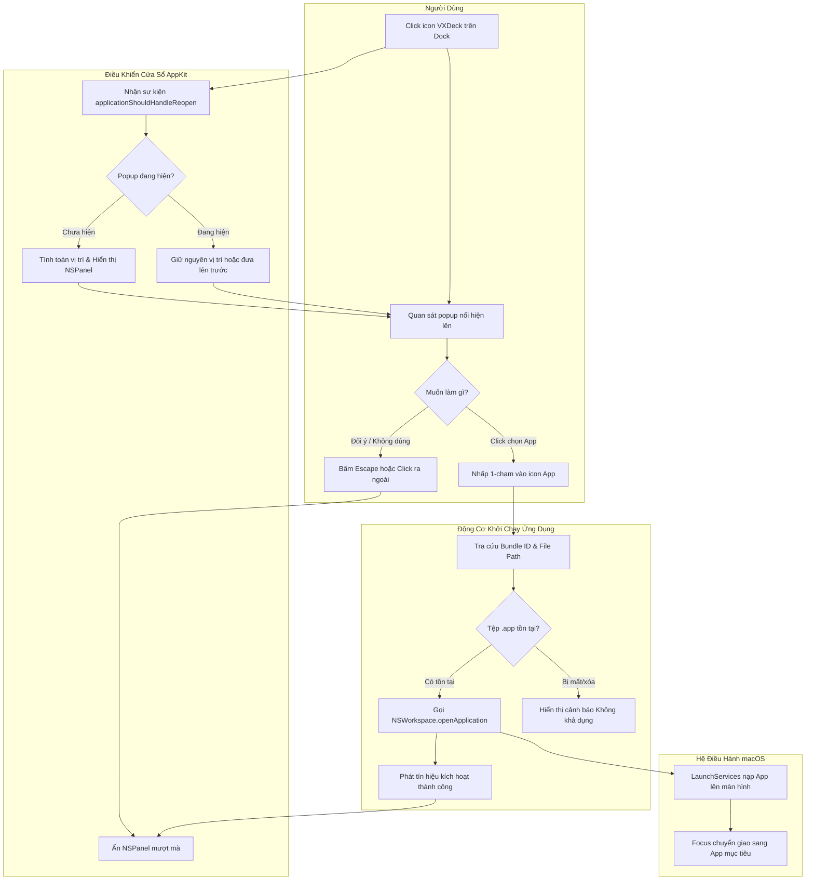
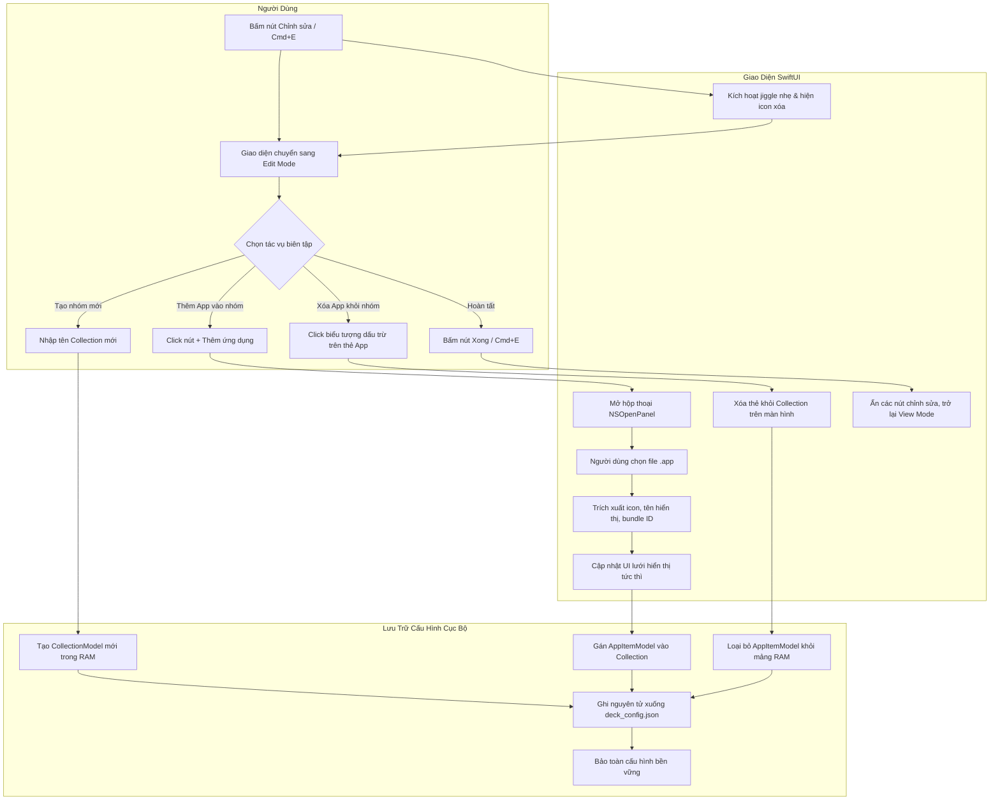
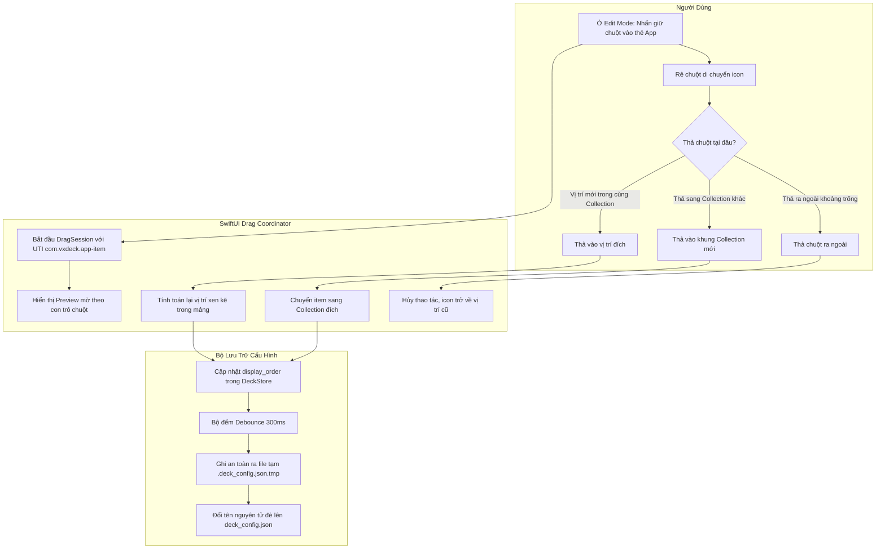

# 01. Quy trình Nghiệp vụ — VXDeck (`_spec1_business_process`)

> **Tên sản phẩm:** VXDeck (Lightweight Curated Application Launcher Popup)  
> **Thư mục dự án:** `vxdeck`  
> **Phiên bản tài liệu:** 1.0.0  
> **Ngày cập nhật:** 2026-10-28  
> **Tài liệu liên quan:** [00_system_overview.md](00_system_overview.md) | [02_feature_flow.md](02_feature_flow.md)

---

## 1. Mục đích & Phạm vi Nghiệp vụ

Tài liệu này chuẩn hóa toàn bộ các quy trình nghiệp vụ ở cấp độ **Vĩ mô (Macro Business Processes)** của VXDeck, mô tả sự phối hợp chặt chẽ giữa 5 chủ thể (Actors & Systems):
1. **Người dùng (User):** Thao tác chuột, bàn phím và trực giác sắp xếp không gian làm việc.
2. **Giao diện VXDeck (UI Presentation):** Lưới biểu tượng, bảng bộ sưu tập và chế độ chỉnh sửa.
3. **Bộ điều khiển Cửa sổ (Windowing Controller):** Quản lý trạng thái hiển thị, focus, sự kiện click ngoài.
4. **Bộ lưu trữ Cấu hình Cục bộ (Config & Storage Engine):** Đọc và ghi dữ liệu nguyên tử vào ổ đĩa.
5. **Hệ điều hành macOS (LaunchServices & NSWorkspace):** Quản lý biểu tượng Dock, giải mã Bundle ID, trích xuất icon và khởi chạy tiến trình ứng dụng.

---

## 2. Mô hình SIPOC (Supplier — Input — Process — Output — Customer)

### 2.1. SIPOC 1: Quy trình Kích hoạt & Khởi chạy Ứng dụng (1-Click Launch)
- **Supplier (Nhà cung cấp):** Người dùng, macOS LaunchServices.
- **Input (Đầu vào):** Thao tác click biểu tượng VXDeck trên Dock; thao tác click vào icon app mục tiêu; cấu hình `deck_config.json`.
- **Process (Quy trình):**
  1. macOS gửi sự kiện `reopen` tới VXDeck.
  2. VXDeck kiểm tra trạng thái: nếu cửa sổ đang ẩn → hiển thị popup tại màn hình tương ứng.
  3. Người dùng nhấp chuột một lần (single-click) vào biểu tượng ứng dụng mong muốn.
  4. Hệ thống kiểm tra tính khả dụng của file `.app` (dựa trên Bundle ID / File Path).
  5. Gọi `NSWorkspace.shared.openApplication` để kích hoạt app mục tiêu.
  6. Tự động ẩn popup VXDeck (mặc định) và chuyển giao focus cho app vừa mở.
- **Output (Đầu ra):** Ứng dụng mục tiêu mở ra màn hình; popup VXDeck ẩn gọn gàng; không để lại cửa sổ rác.
- **Customer (Người thụ hưởng):** Người dùng (tiết kiệm thời gian, không bị ngắt quãng dòng suy nghĩ).

### 2.2. SIPOC 2: Quy trình Thêm Ứng dụng vào Bộ sưu tập (Add App Curation)
- **Supplier (Nhà cung cấp):** Người dùng, Hệ thống tệp macOS (`/Applications`, `~/Applications`).
- **Input (Đầu vào):** Thao tác click nút `[+ Thêm ứng dụng]` trong một Collection; tệp `.app` được chọn từ hộp thoại `NSOpenPanel`.
- **Process (Quy trình):**
  1. Người dùng chọn Collection muốn nạp thêm app.
  2. Hệ thống mở hộp thoại chọn tệp native `NSOpenPanel` có bộ lọc chỉ cho chọn thư mục gói `.app`.
  3. Người dùng trỏ tới app và bấm Open.
  4. Hệ thống trích xuất Metadata: Tên hiển thị (`CFBundleDisplayName` / `CFBundleName`), Bundle Identifier (`CFBundleIdentifier`), đường dẫn tuyệt đối, và icon native.
  5. Kiểm tra tính trùng lặp trong Collection.
  6. Thêm bản ghi mới vào danh sách trong RAM và kích hoạt ghi nguyên tử xuống đĩa.
- **Output (Đầu ra):** Biểu tượng app mới xuất hiện ngay lập tức trong Collection; file cấu hình được cập nhật an toàn.
- **Customer (Người thụ hưởng):** Người dùng (tùy biến được danh sách làm việc theo đúng ý muốn).

### 2.3. SIPOC 3: Quy trình Tùy biến Sắp xếp (Edit Mode & Drag-and-Drop)
- **Supplier (Nhà cung cấp):** Người dùng (Cử chỉ kéo thả chuột).
- **Input (Đầu vào):** Chuyển sang Edit Mode (qua nút bấm hoặc phím tắt `Cmd + E`); thao tác kéo thả icon.
- **Process (Quy trình):**
  1. Người dùng kích hoạt Edit Mode → Giao diện chuyển sang trạng thái biên tập (hiển thị nút xóa, tay cầm kéo).
  2. Hệ thống tạm thời khóa cơ chế tự ẩn cửa sổ khi mất focus.
  3. Người dùng kéo một icon trong cùng Collection hoặc thả sang Collection khác.
  4. Hệ thống cập nhật lại chỉ mục thứ tự (`display_order`) của các phần tử.
  5. Ghi nhận thay đổi xuống đĩa với cơ chế tiết lưu (Debounce 300ms).
  6. Người dùng bấm "Xong" (`Checkmark`) để trở lại View Mode bình thường.
- **Output (Đầu ra):** Bảng sưu tập được sắp xếp theo đúng vị trí không gian người dùng mong muốn; không xảy ra lỗi click nhầm mở app khi đang kéo.
- **Customer (Người thụ hưởng):** Người dùng cá nhân hóa hoàn toàn giao diện làm việc.

---

## 3. Biểu đồ Quy trình Nghiệp vụ (BPMN 2.0 / Swimlane Diagrams)

### 3.1. Swimlane 1: Khởi động Popup từ Dock & Mở Ứng dụng Mục tiêu (Happy Path)

### 3.2. Swimlane 2: Quản lý Bộ sưu tập & Thêm Ứng dụng trong Edit Mode

### 3.3. Swimlane 3: Kéo Thả Sắp Xếp (Drag-and-Drop) & Bảo Vệ Cấu Hình

---

## 4. Ma trận Quyết định Nghiệp vụ (Decision Tables / Matrices)

### 4.1. Ma trận 1: Hành vi Đóng / Ẩn Popup (Dismissal Policy)

| ID | Trạng thái hiện tại | Sự kiện kích hoạt (Event) | Hành động của Hệ thống | Trạng thái Cửa sổ sau đó |
| :--- | :--- | :--- | :--- | :--- |
| **D1** | View Mode (Bình thường) | Click vào một App hợp lệ | Gọi `openApplication` → Kiểm tra `auto_hide_on_launch` → Ẩn popup khi thành công | Ẩn (`Hidden`) |
| **D2** | View Mode (Bình thường) | Nhấn phím cứng `Escape` | Ẩn popup ngay lập tức | Ẩn (`Hidden`) |
| **D3** | View Mode (Bình thường) | Click chuột ra ngoài cửa sổ | Ẩn popup ngay lập tức | Ẩn (`Hidden`) |
| **D4** | Bất kỳ (Ẩn hoặc Hiện) | Click icon VXDeck trên thanh Dock | **Luôn Hiện / Đưa lên trước** (`makeKeyAndOrderFront`), triệt tiêu xung đột với click ngoài | Hiện (`Active View`) |
| **D5** | Edit Mode (Đang sửa) | Click ra ngoài hoặc mất focus | **KHÔNG ẨN CỬA SỔ** (Bảo vệ phiên sửa) | Giữ nguyên (`Active Edit`) |
| **D6** | Edit Mode (Đang sửa) | Mở hộp thoại `NSOpenPanel` | **KHÔNG ẨN CỬA SỔ** (Khóa click ngoài, giữ panel mẹ phía sau) | Giữ nguyên (`Modal Open`) |
| **D7** | Edit Mode (Đang sửa) | Đang kéo rê chuột (Dragging) | **KHÔNG ẨN CỬA SỔ** dù con trỏ ra ngoài viền | Giữ nguyên (`Dragging`) |
| **D8** | Edit Mode (Đang sửa) | Nhấn phím cứng `Escape` | Thoát khỏi Edit Mode, quay về View Mode | Hiện (`Active View`) |

### 4.2. Ma trận 2: Khởi chạy Ứng dụng & Xử lý Trạng thái Ngoại lệ

| ID | Trạng thái của Ứng dụng đích | Kiểm tra Bundle ID | Kiểm tra File Path | Hành động của VXDeck | Phản hồi Giao diện |
| :--- | :--- | :--- | :--- | :--- | :--- |
| **L1** | Ứng dụng bình thường | Trùng khớp Bundle ID | Tệp tồn tại ở path đã lưu | Mở ứng dụng ngay qua `NSWorkspace` | Ẩn popup nếu `auto_hide = true` |
| **L2** | Tệp bị thay thế tại path cũ | Không khớp Bundle ID | Có tệp nhưng khác Bundle ID | **Từ chối mở để chống nhầm app** | Hiển thị cảnh báo: Tệp tại đường dẫn không khớp định danh |
| **L3** | Ứng dụng đã bị di chuyển thư mục | Trùng khớp Bundle ID | Không thấy ở path cũ | Dò tìm ứng viên qua Bundle ID; nếu duy nhất và chứng minh được danh tính thì cập nhật path | Mở app và lưu path mới; nếu không chắc chắn thì yêu cầu định vị lại |
| **L4** | Ứng dụng đã bị gỡ cài đặt hoàn toàn | Không tìm thấy | Không tồn tại | Không mở ứng dụng; giữ nguyên popup | Bật popover: "Không tìm thấy app. Xóa hoặc định vị lại?" |
| **L5** | Ứng dụng đang chạy sẵn ngầm | Trùng khớp Bundle ID | Tệp tồn tại | Kích hoạt (bring to front) app đó | Chuyển focus sang app đó mượt mà |
| **L6** | Tệp bị mất quyền đọc/thực thi | Trùng khớp Bundle ID | Tệp bị khóa quyền | Báo lỗi hệ thống qua thông báo nhẹ | Hiển thị tooltip lỗi quyền truy cập |

### 4.3. Ma trận 3: Trùng lặp Shortcut & Xóa Bộ sưu tập

| ID | Tình huống Nghiệp vụ | Quy tắc Xử lý của VXDeck | Lý do Nghiệp vụ & Ràng buộc An toàn |
| :--- | :--- | :--- | :--- |
| **R1** | Thêm 1 app vào cùng 1 Collection 2 lần | **Chặn trùng lặp:** Hiển thị thông báo "Ứng dụng này đã có trong nhóm" | Tránh làm bừa bộn và rối mắt lưới icon. |
| **R2** | Thêm 1 app xuất hiện ở 2 Collection khác nhau | **Cho phép hoàn toàn:** Ví dụ Figma vừa nằm ở nhóm "Thiết kế" vừa ở "Dự án A" | Tôn trọng tự do phân loại theo bối cảnh làm việc của người dùng. |
| **R3** | Người dùng xóa 1 shortcut trong Collection | **Chỉ xóa bản ghi cấu hình** trong `deck_config.json` | **Tuyệt đối KHÔNG gỡ cài đặt** hay xóa file `.app` trong máy. |
| **R4** | Người dùng xóa toàn bộ một Collection | Hiển thị hộp thoại xác nhận: "Xóa nhóm X? (Các ứng dụng cài trên máy sẽ không bị ảnh hưởng)" | Ngăn ngừa thao tác bấm nhầm; bảo đảm tính an toàn dữ liệu 100%. |
| **R5** | Người dùng xóa app trên máy qua Finder | VXDeck giữ nguyên shortcut ở trạng thái `Unavailable` cho đến khi người dùng chủ động xóa | Người dùng nhận biết được sự thay đổi để có thể cài lại hoặc dọn dẹp. |
