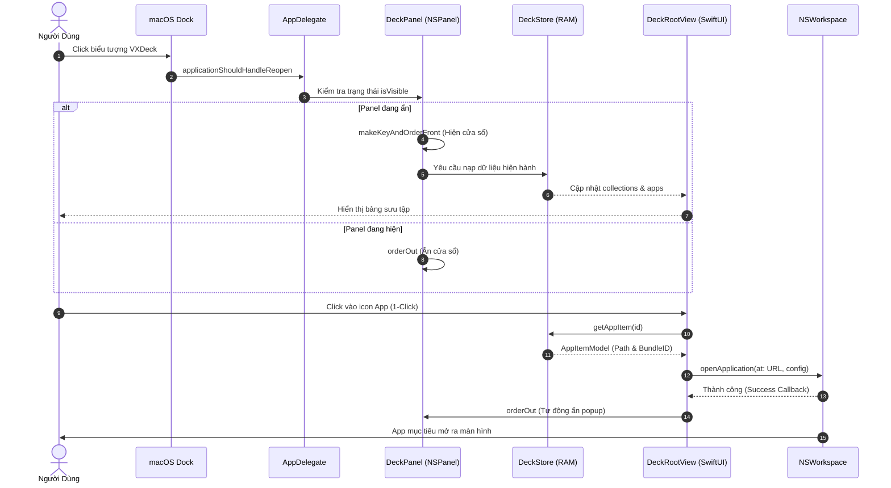
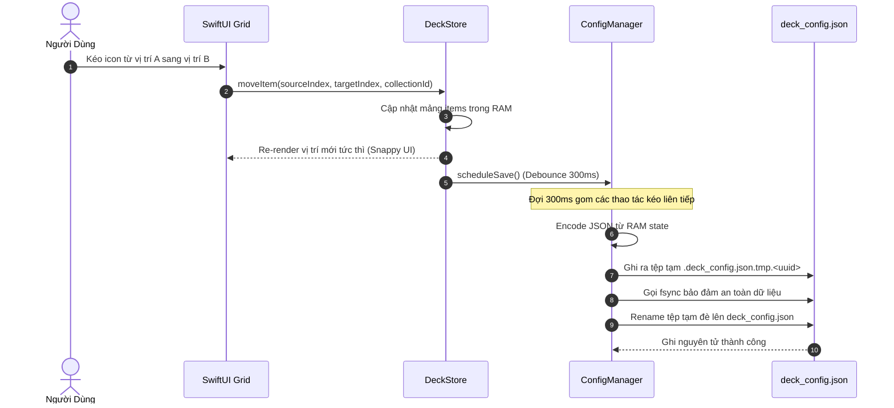
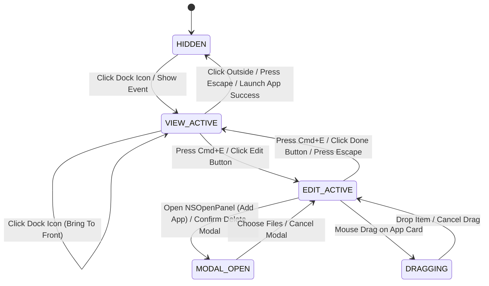

# 02. Luồng Tính năng & Logic Chuyển Trạng thái — VXDeck (`_spec2_feature_flow`)

> **Tên sản phẩm:** VXDeck (Lightweight Curated Application Launcher Popup)  
> **Thư mục dự án:** `vxdeck`  
> **Phiên bản tài liệu:** 1.1.0
> **Ngày cập nhật:** 2026-10-29
> **Tài liệu liên quan:** [00_system_overview.md](00_system_overview.md) | [01_business_process.md](01_business_process.md) | [03_ui_wireframe.md](03_ui_wireframe.md)

---

## 1. Mục đích & Phạm vi

Tài liệu này đặc tả chi tiết toàn bộ các luồng thao tác của người dùng (User Flows), sơ đồ trình tự tương tác hệ thống (Sequence Diagrams), máy trạng thái hữu hạn (Finite State Machine - FSM) và các giao ước logic máy đọc được (Machine-Readable Logic Contracts) của VXDeck ở cấp độ **Chi tiết Tính năng (Micro Feature Level)**.

---

## 2. Chi tiết các Luồng Người dùng (User Flows)

### 2.1. Luồng 1: Kích hoạt Popup từ Dock (Show / Toggle Flow)
1. **Trigger (Kích hoạt):** Người dùng nhấp vào biểu tượng VXDeck trên thanh Dock của macOS.
2. **Hệ thống kiểm tra:**
   - Nếu `WindowFSM == HIDDEN`: Tính toán màn hình chứa con trỏ chuột/Dock hiện tại, đưa `NSPanel` ra giữa hoặc phía trên thanh Dock, chuyển sang `VIEW_ACTIVE`.
   - Nếu `WindowFSM == VIEW_ACTIVE`: Thực hiện ẩn cửa sổ (Toggle behavior), chuyển sang `HIDDEN`.
   - Nếu `WindowFSM == EDIT_ACTIVE`: Đưa cửa sổ lên phía trước (Bring to front) để tiếp tục chỉnh sửa.
3. **Hiển thị dữ liệu:** SwiftUI nạp ngay danh sách các Collection và ứng dụng đã lưu từ RAM mà không mất thời gian tải lại (Zero-Latency Rendering).

### 2.2. Luồng 2: 1-Click Launch Ứng dụng (Launch & Auto-Hide)
1. **Trigger (Kích hoạt):** Người dùng nhấp chuột trái một lần vào một biểu tượng ứng dụng trong lưới.
2. **Kiểm tra trạng thái (Pre-condition):**
   - Đảm bảo `WindowFSM == VIEW_ACTIVE` (ở `EDIT_ACTIVE` click chỉ để chọn, không mở app).
   - Kiểm tra thuộc tính `is_available` của ứng dụng.
3. **Thực thi:**
   - Nếu `is_available == true`:
     1. Gửi lệnh tới `NSWorkspace.shared.openApplication(at:configuration:completionHandler:)`.
     2. Giao diện tạo hiệu ứng phản hồi nhấp (Click scale-down 95% trong 80ms).
     3. Đợi tiến trình macOS tiếp nhận (sau 100ms - 150ms), tự động ẩn cửa sổ VXDeck.
     4. Focus hệ thống tự động thuộc về ứng dụng vừa mở.
   - Nếu `is_available == false`:
     1. Không ẩn cửa sổ.
     2. Hiển thị thông báo nhẹ: "Không tìm thấy file ứng dụng tại đường dẫn đã lưu. Vui lòng định vị lại hoặc xóa khỏi danh sách".

### 2.3. Luồng 3: Bật / Tắt Chế độ Chỉnh sửa (Toggle Edit Mode)
1. **Trigger (Kích hoạt):** Người dùng nhấp nút biểu tượng `[Chỉnh sửa]` (hình bút chì) trên thanh tiêu đề, hoặc nhấn tổ hợp phím `Cmd + E`.
2. **Chuyển đổi:**
   - Hệ thống chuyển `WindowFSM` từ `VIEW_ACTIVE` sang `EDIT_ACTIVE`.
   - Khóa cơ chế đóng tự động khi mất focus (`hidesOnDeactivate = false`).
   - Giao diện SwiftUI chuyển đổi hình thái:
     - Nút bút chì đổi thành nút hoàn tất `[Xong]` (hình dấu tích xanh).
     - Mỗi thẻ icon hiển thị thêm nút xóa nhỏ góc trên bên trái (`badge-delete`).
     - Cuối mỗi Collection hiển thị nút `[+ Thêm ứng dụng]` dạng nét đứt.
     - Dưới cùng hiển thị nút `[+ Thêm bộ sưu tập mới]`.
3. **Thoát Edit Mode:** Nhấn lại nút `[Xong]` hoặc phím `Cmd + E` hoặc `Escape` → Hệ thống lưu mọi thay đổi xuống đĩa và chuyển về `VIEW_ACTIVE`.

### 2.4. Luồng 4: Thêm Ứng dụng vào Collection qua File Picker
1. **Trigger:** Ở `EDIT_ACTIVE`, người dùng bấm nút `[+ Thêm ứng dụng]` trong một Collection.
2. **Khởi tạo Picker:**
   - Hệ thống chuyển sang trạng thái phụ `MODAL_BLOCKING` (ngăn đóng cửa sổ chính).
   - Gọi `NSOpenPanel` native của AppKit:
     - `allowsMultipleSelection = true` (cho phép chọn nhiều app cùng lúc).
     - `canChooseDirectories = false`.
     - `canChooseFiles = true`.
     - `allowedContentTypes = [.application, .applicationBundle]`.
     - `directoryURL = URL(fileURLWithPath: "/Applications")`.
3. **Xử lý lựa chọn:**
   - Người dùng chọn 1 hoặc nhiều app và bấm **Open**:
     - Với mỗi URL được chọn:
       - Đọc `CFBundleIdentifier` từ `Bundle(url:)`.
       - Đọc tên hiển thị (`CFBundleDisplayName` hoặc tên tệp bỏ đuôi `.app`).
       - Lưu đường dẫn tuyệt đối (Absolute Path).
       - Kiểm tra nếu app chưa tồn tại trong Collection này → Thêm vào mảng `items`.
   - Người dùng bấm **Cancel**: Đóng picker mà không thay đổi dữ liệu.
4. **Kết thúc:** Đóng `NSOpenPanel`, phục hồi trạng thái `EDIT_ACTIVE`, lưu dữ liệu nguyên tử xuống đĩa.

### 2.5. Luồng 5: Kéo Thả Sắp Xếp (Drag-and-Drop Reordering)
1. **Trigger:** Trong `EDIT_ACTIVE`, người dùng nhấn giữ chuột trái trên một thẻ icon app và kéo rê.
2. **Khởi tạo Drag:**
   - SwiftUI khởi tạo `NSItemProvider` với định danh riêng `com.vxdeck.app-item`.
   - Thẻ nguồn chuyển sang trạng thái bán trong suốt (`opacity = 0.4`).
3. **Rê chuột qua vùng đích (Hover Drop Target):**
   - Rê qua các vị trí trong cùng Collection: Hiển thị vạch chỉ báo chèn màu Cyan (`drop indicator`).
   - Rê sang Collection khác: Khung Collection đích sáng viền Cyan nhẹ, sẵn sàng nhận phần tử mới.
4. **Thả chuột (Drop Event):**
   - Người dùng nhả chuột tại vị trí hợp lệ:
     - Hệ thống dời `AppItemModel` từ vị trí cũ sang vị trí mới trong RAM.
     - Tái đánh số `display_order` cho toàn bộ danh sách.
     - Kích hoạt ghi file cấu hình với debounce 300ms.
   - Người dùng thả ra ngoài vùng cho phép: Thao tác bị hủy (icon bật quay về vị trí ban đầu).

---

## 3. Sơ đồ Trình tự Hệ thống (Sequence Diagrams)

### 3.1. Sequence 1: Kích hoạt Popup từ Dock & Mở App



### 3.2. Sequence 2: Kéo Thả Sắp Xếp & Lưu Cấu Hình Nguyên Tử



---

## 4. Máy Trạng thái Hữu hạn (Finite State Machine - FSM)

### 4.1. FSM Cửa sổ Ứng dụng (`WindowFSM`)



### 4.2. Ma trận Chuyển trạng thái Cửa sổ (State Transition Matrix)

| Trạng thái Ban đầu | Sự kiện (Trigger) | Điều kiện (Guard Condition) | Hành động Hệ thống | Trạng thái Tiếp theo |
| :--- | :--- | :--- | :--- | :--- |
| `HIDDEN` | Click Dock Icon | Cửa sổ đang ẩn | Định vị màn hình active, `makeKeyAndOrderFront`, tạo `session_id` mới | `VIEW_ACTIVE` |
| `VIEW_ACTIVE` | Click Dock Icon | Cửa sổ đang hiện | Đưa cửa sổ lên phía trước (`orderFrontRegardless`) | `VIEW_ACTIVE` |
| `VIEW_ACTIVE` | Click ngoài cửa sổ | Con trỏ click ra ngoài frame | Gọi `orderOut` ẩn cửa sổ, hủy timer dở | `HIDDEN` |
| `VIEW_ACTIVE` | Nhấn phím `Escape` | Không có modal | Gọi `orderOut` ẩn cửa sổ | `HIDDEN` |
| `VIEW_ACTIVE` | Click vào thẻ App | `app.isAvailable == true` | Chạy `launch_application`, ẩn khi callback thành công & `auto_hide = true` | `HIDDEN` hoặc giữ nguyên |
| `VIEW_ACTIVE` | Bấm nút Sửa / `Cmd+E` | Không có modal | Khóa auto-hide, tăng `session_id`, bật UI edit mode | `EDIT_ACTIVE` |
| `EDIT_ACTIVE` | Bấm nút Xong / `Cmd+E` | Đang ở edit mode | Bật lại auto-hide, tắt UI edit, ép `flush()` lưu đĩa | `VIEW_ACTIVE` |
| `EDIT_ACTIVE` | Nhấn phím `Escape` | Đang ở edit mode | Thoát chế độ sửa về xem, ép `flush()` lưu đĩa | `VIEW_ACTIVE` |
| `EDIT_ACTIVE` | Click ngoài cửa sổ | `is_modal_open == false` | **Bỏ qua sự kiện**, giữ nguyên cửa sổ phiên sửa | `EDIT_ACTIVE` |
| `EDIT_ACTIVE` | Bấm nút `+ Thêm App` | Collection hợp lệ | Đặt `is_modal_open = true`, mở `NSOpenPanel.beginSheetModal(for:)` gắn với `AppDelegate.panel` đang hiển thị | `MODAL_OPEN` |
| `MODAL_OPEN` | Bấm Open / Cancel | File picker kết thúc | Chỉ cập nhật store khi Open; Cancel không đổi dữ liệu; xóa `is_modal_open`, trả focus về popup, giữ Edit Mode | `EDIT_ACTIVE` |
| `EDIT_ACTIVE` | Nhấn giữ & Kéo thẻ | Khoảng cách kéo > 4pt | Bắt đầu DragSession với UTI `com.vxdeck.app-item` | `DRAGGING` |
| `DRAGGING` | Thả chuột vị trí mới | Tọa độ trong drop area | Chạy transaction `reorder_items` trong store, lưu đĩa | `EDIT_ACTIVE` |
| `DRAGGING` | Thả chuột ra ngoài | Tọa độ ngoài drop area | Hủy thao tác, icon lướt về vị trí cũ | `EDIT_ACTIVE` |

---

### 4.3. Browse trên popup nổi (feedback 2026-10-29)

- Không mở Browse bằng `begin` độc lập: window level của popup nổi có thể che picker. Dùng sheet gắn đúng popup đang key, không nâng picker lên level toàn hệ thống.
- Chặn mở thêm picker khi có modal/sheet; click ngoài không đóng popup trong phiên Browse. Reopen từ Dock khi có sheet phải đưa sheet lên trước.
- Open thêm ứng dụng vào đúng collection và flush; Cancel/Escape không thay config. Cả hai trả focus về popup, giữ Edit Mode. Khi trở về View Mode, click ngoài vẫn ẩn popup như trước.
- Không thay Settings, icon, titlebar hoặc updater trong thay đổi nghiệp vụ này.

---

## 5. Giao ước Thực thi Logic (Machine-Readable Execution Contracts)

### Contract 1: `show_or_activate_deck`
```markdown
- **Function:** `@MainActor show_or_activate_deck(target_screen: NSScreen?)`
- **Pre-conditions:** `NSApplication.shared` đã khởi tạo hoàn tất.
- **Execution Steps:**
  1. Nếu `panel.isVisible == true`:
     - Gọi `panel.makeKeyAndOrderFront(nil)` để đưa cửa sổ lên trên cùng.
     - Kiểm tra nếu `window_state == .hidden`: gán lại `window_state = .viewActive`.
  2. Nếu `panel.isVisible == false`:
     - Xác định `active_screen` từ màn hình chứa con trỏ chuột (`NSEvent.mouseLocation`) hoặc `NSScreen.main`.
     - Tính toán tọa độ trung tâm hoặc neo phía trên thanh Dock: `panel.setFrameOrigin(calculated_point)`.
     - Tăng số định danh phiên: `window_session_id += 1`.
     - Làm mới trạng thái ứng dụng: Quét nhanh `FileManager.default.fileExists` để cập nhật cờ `isAvailable`.
     - Gọi `panel.makeKeyAndOrderFront(nil)`.
     - Gán `window_state = .viewActive`.
```

### Contract 2: `launch_application`
```markdown
- **Function:** `@MainActor launch_application(itemId: UUID, collectionId: UUID)`
- **Pre-conditions:** `window_state == .viewActive`
- **Execution Steps:**
  1. Ghi nhận phiên hiện hành: `let capture_session_id = window_session_id`.
  2. Tìm kiếm `AppItemModel` theo `itemId` trong Collection tương ứng.
  3. Nếu không tìm thấy: Báo lỗi nội bộ, giữ nguyên cửa sổ.
  4. Kiểm tra tính tồn tại và danh tính bundle tại `item.path`:
     - `let file_exists = FileManager.default.fileExists(atPath: item.path)`
     - Nếu `file_exists`:
       - Đọc bundle thực tế: `let actual_bundle_id = Bundle(url: URL(fileURLWithPath: item.path))?.bundleIdentifier`
       - Nếu `item.bundleId != nil` và `actual_bundle_id != item.bundleId`:
         - Báo lỗi: Tệp tại đường dẫn đã bị thay thế bởi ứng dụng khác. Gán `item.isAvailable = false`, DỪNG LẠI.
     - Nếu `!file_exists`:
       - Thử dò tìm ứng viên qua Bundle ID: `guard let bundle_id = item.bundleId, let new_url = NSWorkspace.shared.urlForApplication(withBundleIdentifier: bundle_id) else { ... }`
       - Nếu tìm thấy ứng viên duy nhất hợp lệ: Cập nhật `item.path = new_url.path`, kích hoạt lưu đĩa.
       - Nếu không tìm thấy: Gán `item.isAvailable = false`, hiển thị thông báo yêu cầu định vị lại, DỪNG LẠI.
  5. Tạo cấu hình: `let config = NSWorkspace.OpenConfiguration(); config.activates = true`.
  6. Gọi `NSWorkspace.shared.openApplication(at: URL(fileURLWithPath: item.path), configuration: config)`:
     - Trong Completion Handler, điều phối ngay về `@MainActor`:
       - Nếu có lỗi (`error != nil`): Hiển thị thông báo thất bại lên UI, không ẩn panel.
       - Nếu thành công (`error == nil`):
         - Kiểm tra điều kiện bảo vệ:
           - `window_session_id == capture_session_id` (Phiên làm việc chưa bị mở lại)
           - `window_state == .viewActive` (Người dùng chưa bấm vào Edit Mode)
           - `store.settings.autoHideOnLaunch == true` (Tôn trọng cài đặt người dùng)
         - Nếu thỏa mãn cả 3 điều kiện: Đợi 100ms rồi gọi `panel.orderOut(nil)`, gán `window_state = .hidden`.
```

### Contract 3: `add_app_to_collection`
```markdown
- **Function:** `@MainActor add_app_to_collection(collectionId: UUID, appUrls: [URL])`
- **Pre-conditions:** `window_state == .editActive` hoặc `.modalOpen`
- **Execution Steps:**
  1. Lấy chỉ mục Collection đích trong mảng `store.collections`: `guard let col_idx = store.collections.firstIndex(where: { col in col.id == collectionId }) else { return }`.
  2. Duyệt qua từng `url` trong `appUrls`:
     - Xác thực `url.pathExtension.lowercased() == "app"`. Nếu sai → Bỏ qua URL đó.
     - Đọc Bundle: `guard let bundle = Bundle(url: url) else { continue }`.
     - Trích xuất:
       - `bundle_id = bundle.bundleIdentifier` (Lưu `nil` nếu không có, không gán chuỗi rỗng `""`)
       - `app_name = bundle.infoDictionary?["CFBundleDisplayName"] as? String ?? bundle.infoDictionary?["CFBundleName"] as? String ?? url.deletingPathExtension().lastPathComponent`
       - `app_path = url.path`
     - Kiểm tra trùng lặp trong Collection đích:
       - Nếu đã có item trùng `bundle_id` (khi `bundle_id != nil`) HOẶC trùng `path` → Bỏ qua không thêm đúp.
     - Tính toán `next_order = store.collections[col_idx].items.count`.
     - Tạo `newItem = AppItemModel(id: UUID(), name: app_name, customLabel: nil, bundleId: bundle_id, path: app_path, displayOrder: next_order, addedAt: Date(), isAvailable: true)`.
     - Thêm trực tiếp: `store.collections[col_idx].items.append(newItem)`.
  3. Kích hoạt lưu đĩa: `ConfigManager.shared.scheduleAtomicSave(debounce_ms: 300)`.
```

### Contract 4: `reorder_items`
```markdown
- **Function:** `@MainActor reorder_items(itemId: UUID, sourceCollectionId: UUID, targetCollectionId: UUID, targetIndex: Int)`
- **Pre-conditions:** `window_state == .dragging` hoặc `window_state == .editActive`
- **Execution Steps:**
  1. Tìm chỉ mục Collection nguồn: `guard let src_col_idx = store.collections.firstIndex(where: { col in col.id == sourceCollectionId }) else { return }`.
  2. Tìm chỉ mục Collection đích: `guard let tgt_col_idx = store.collections.firstIndex(where: { col in col.id == targetCollectionId }) else { return }`.
  3. Tìm chỉ mục item nguồn trong Collection nguồn: `guard let src_item_idx = store.collections[src_col_idx].items.firstIndex(where: { item in item.id == itemId }) else { return }`.
  4. Phân nhánh xử lý:
     - **Trường hợp A: Kéo thả trong cùng một Collection (`sourceCollectionId == targetCollectionId`):**
       - Sử dụng hàm chuẩn: `store.collections[src_col_idx].items.move(fromOffsets: IndexSet(integer: src_item_idx), toOffset: min(targetIndex, store.collections[src_col_idx].items.count))`.
     - **Trường hợp B: Kéo thả sang Collection khác (`sourceCollectionId != targetCollectionId`):**
       - Lấy item nguồn ra: `let moving_item = store.collections[src_col_idx].items.remove(at: src_item_idx)`.
       - Kiểm tra chống trùng: Nếu Collection đích đã có item cùng `bundleId` hoặc `path`:
         - Hủy thao tác: Chèn lại item về vị trí cũ trong Collection nguồn: `store.collections[src_col_idx].items.insert(moving_item, at: src_item_idx)`, DỪNG LẠI.
       - Chèn item vào Collection đích: `let clamped_idx = max(0, min(targetIndex, store.collections[tgt_col_idx].items.count))`.
       - `store.collections[tgt_col_idx].items.insert(moving_item, at: clamped_idx)`.
       - Đánh lại `displayOrder` cho Collection nguồn: `for (idx, _) in store.collections[src_col_idx].items.enumerated() { store.collections[src_col_idx].items[idx].displayOrder = idx }`.
  5. Đánh lại `displayOrder` cho Collection đích: `for (idx, _) in store.collections[tgt_col_idx].items.enumerated() { store.collections[tgt_col_idx].items[idx].displayOrder = idx }`.
  6. Kích hoạt lưu đĩa có tiết lưu: `ConfigManager.shared.scheduleAtomicSave(debounce_ms: 300)`.
```
